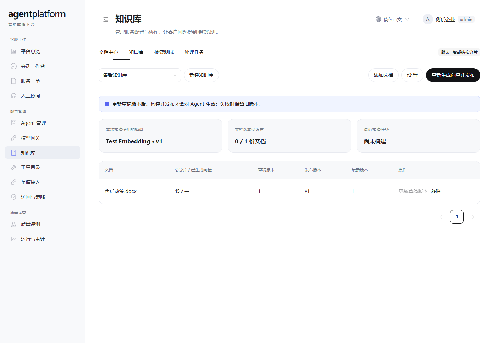
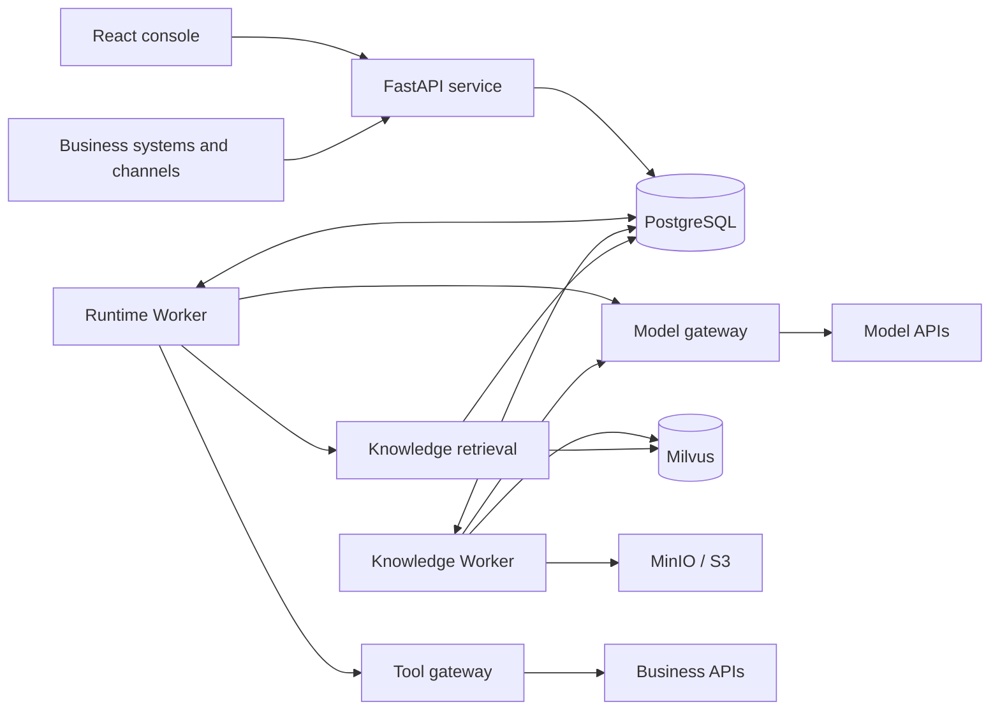

# NexusDesk

**English** · [简体中文](README.zh-CN.md) · [Website](https://www.aidet.top/en/index.html)

> 中文用户请阅读 [简体中文 README](README.zh-CN.md)。 / Chinese-speaking users: see the [简体中文 README](README.zh-CN.md).

[](https://github.com/GroundedCore/nexusdesk/actions/workflows/ci.yml) [](LICENSE) [](https://github.com/GroundedCore/nexusdesk/releases) [](https://hub.docker.com/r/groundedcore/nexusdesk-quickstart) [](https://www.aidet.top/en/index.html)

**An AI agent-powered platform for intelligent customer service and service collaboration.**

For teams that must keep customer service data on their own network, this is a **self-hosted, lighter-weight alternative to Intercom / Zendesk** (Apache-2.0; most projects in this space are AGPL-3.0).

NexusDesk connects knowledge retrieval, business tool invocation, human collaboration, and ticket handling into a single customer service flow, helping teams build agents that can answer questions, execute tasks, and follow up on outcomes. Built with Python, LangGraph, and React.

**No Redis. No Kubernetes.** One Postgres handles both storage and the job queue; a single Compose file brings the stack up.


The demo follows one path: ask a question → hit a knowledge citation → the agent drafts a ticket → a human confirms → the ticket is created. The quickstart uses a mock model and illustrates the flow only; it does not represent real answer quality.

```bash
sh nexusdesk quickstart    # two containers, no model key required
```

Then open **https://localhost:8080** and select the `sample-support` conversation:

- Enter `发货需要多久？` ("How long does shipping take?") to try knowledge Q&A.
- Enter `帮我创建工单` ("Help me create a ticket") to try the draft, confirm, and create flow.

> The quickstart ships its own self-signed certificate; the first visit warns about it, and importing `/data/tls/ca.crt` from the container removes the warning (see [Quickstart](#quickstart)).

[Quickstart](#quickstart) · [Production deployment](#production-deployment) · [Why NexusDesk](#why-nexusdesk) · [Documentation](#documentation) · [Contributing](#contributing)

> The project is under continuous development and already has a working core customer service flow. Current capabilities and planned work are described separately; the scope of deployment validation is recorded in the [validation record](deploy/validation-20260923.md).

## Why NexusDesk

These are not feature bullets — they are architectural trade-offs we made on purpose.

| Trade-off | How it works | Who cares |
| --- | --- | --- |
| **A smaller operational surface** | Postgres serves as datastore, job queue, and cross-process message channel. No Redis. | Teams deploying into a customer's internal network, facing a security review per component, with limited ops headcount. Every middleware you drop is one less review, one less runbook, one less failure mode. |
| **Writes are gated by a human** | Agents cannot perform irreversible business actions. For ticket creation, an agent can only **draft**; a human confirms before anything is written. A conversation can also be handed to a person at any point. | Teams that will not let an AI change business systems on its own. |
| **Every change is traceable** | Agent configuration is draft / publish / rollback with version diffing; model calls are quota-metered; runs emit event logs and operations are audited. | Compliance and security reviews that require changes to be reversible. |

## Channels and integrations

| Category | Supported |
| --- | --- |
| Channel access | Embedded chat widget, channel API (HMAC signatures + message-ID deduplication), open platform API (signed webhooks with retries, idempotency keys, SSE streaming) |
| Messaging platforms | WeCom, WeChat Customer Service, Feishu, DingTalk, Slack, Telegram, Discord (native adapters) |
| Enterprise identity | OIDC, WeCom, DingTalk, Feishu |
| Model access | Any OpenAI-compatible service; Chat / Embedding / Rerank / OCR / speech, with connections and versioned profiles managed in one place |
| Knowledge sources | External parser (PDF, Office, images, depending on the parser implementation), plain TXT / Markdown; Milvus vector index and MinIO / S3 archival (opt-in) |
| Middleware | **PostgreSQL only** is required; Milvus and S3 are opt-in, **Redis is not used** |
| Deployment shape | Docker Compose: 2 containers for the quickstart / 6 long-running services plus a one-shot migration task in production; no Kubernetes or Helm yet |
| UI languages | Simplified Chinese, Traditional Chinese, English, Hindi |

## How it differs

| Dimension | NexusDesk | General-purpose LLM app platforms | Knowledge-base Q&A platforms | Open-source helpdesk systems |
| --- | --- | --- | --- | --- |
| Focus | Customer service and collaboration | General app orchestration | Knowledge-base Q&A | Human ticket handling |
| Ticket and handoff loop | Built in | Build it yourself | Build it yourself | Built in |
| Writes require human confirmation | Built in | Build it yourself | Build it yourself | Not applicable |
| Is Redis required | No | Yes | Yes | Yes |
| Agent versioning and rollback | Built in | Partial | Partial | Not applicable |
| Model quota and metering | Built in | Partial | Partial | Not applicable |
| License | Apache-2.0 | See each project | See each project | See each project |

Information about other projects should be checked against their own documentation; this table only illustrates differences in design orientation and is not an assessment of any product.

### Current implementation status (honest notes)

- Retrieval: the runtime defaults to **keyword search**. Vector search requires your own Milvus and is not yet validated end to end.
- The quickstart uses a **mock model**. It does not represent real answer quality and connects to no real business system.
- Deployment: **Docker Compose** only. No Kubernetes or Helm charts yet.
- The project is under continuous development and **is not production ready**. See the [module delivery notes](docs/modules-delivery.md).

## Product preview



Knowledge workspace: manage documents, chunks, indexes, and published versions. The screenshot uses test data.

## Core capabilities

| Capability | What you can do |
| --- | --- |
| Agent configuration and execution | Configure and publish agents; run reasoning and tool calls through an asynchronous LangGraph ReAct loop |
| Knowledge base and retrieval | Ingest documents, configure chunking, preview content, build vector indexes, and test retrieval quality |
| Unified model integration | Manage connections, catalogs, and versioned profiles for Chat, Embedding, Rerank, OCR, and speech models |
| Business tool integration | Connect business APIs and manage invocation credentials, parameters, and execution permissions |
| Human collaboration and tickets | Support conversation takeover, ticket drafting, and confirmation so issues that need follow-up enter the service flow |
| Channels and application access | Expose customer service capabilities to business systems through channel interfaces and application APIs |
| Observability and evaluation | Review execution records, tool calls, and evaluation results to troubleshoot issues and improve continuously |

Typical flow: a user asks a question → the agent retrieves knowledge or calls a business tool → the result is returned → a human handoff or a ticket confirmation happens as needed.

## Quickstart

Requires Docker and Docker Compose v2 (on Docker Desktop, select Linux containers). Pick either of the two ways to start.

**Option 1: build locally.** Run this from the project root. The first run needs network access and compiles the frontend, which takes a few minutes.

```bash
# Linux / macOS
sh nexusdesk quickstart
```

```powershell
# Windows PowerShell
.\nexusdesk.ps1 quickstart
```

**Option 2: use the published image.** Skips the frontend build and starts from the prebuilt image. Run this from the project root.

```bash
NEXUSDESK_IMAGE_REGISTRY=docker.io/groundedcore/ NEXUSDESK_VERSION=latest \
  docker compose -f deploy/quickstart/compose.yaml up -d
```

The image is published to both [GHCR](https://github.com/GroundedCore/nexusdesk/pkgs/container/nexusdesk-quickstart) and [Docker Hub](https://hub.docker.com/r/groundedcore/nexusdesk-quickstart) with identical contents, so pick whichever your network prefers: Docker Hub rate-limits anonymous pulls, GHCR does not. `NEXUSDESK_VERSION` must be given explicitly — its default, `local`, only exists after a local build.

Without cloning the repository, this one compose file is all you need. Run it from any directory:

```bash
curl -fsSLo compose.yaml \
  https://raw.githubusercontent.com/GroundedCore/nexusdesk/main/deploy/quickstart/compose.yaml

NEXUSDESK_IMAGE_REGISTRY=docker.io/groundedcore/ NEXUSDESK_VERSION=latest \
  docker compose -f compose.yaml up -d
```

Open **https://localhost:8080**, then open `sample-support` in the conversation workbench:

- Enter `发货需要多久？` ("How long does shipping take?") to try knowledge Q&A.
- Enter `帮我创建工单` ("Help me create a ticket") to try the draft, confirm, and create flow.

The demo ships its own self-signed certificate, so reaching it over a LAN IP or an internal hostname is still a secure context and the browser secure-context restrictions (`crypto.randomUUID`, clipboard access) stay out of the way. The first visit warns about the untrusted certificate; importing `/data/tls/ca.crt` from the container removes that. When using a LAN address, set `NEXUSDESK_TLS_HOSTS` so the certificate covers it — see the [deployment guide](deploy/README.md).

Nine industry case sets are also loaded: 9 knowledge bases, 18 agent drafts, and 36 documents. Every resource name carries the `[案例]` prefix, the agent list can be filtered with "examples only", and the case agents are pre-bound to the demo Chat profile so they are ready to chat.

Only two containers (App + PostgreSQL) are started, and no model key is required. The preset scenario uses a mock model and the page shows a demo badge; it is for local evaluation only and does not represent real model answer quality.

> **Keep the two demo inputs above in Chinese.** The mock model triggers on hard-coded Chinese phrases (`工单` selects the ticket tool), and the seeded demo documents are Chinese, so translated inputs will not exercise the same paths.

> **Security note**: the quickstart entry point injects no identity, and requests without credentials are rejected by the API outright. But the login credentials `admin / nexusdesk` are published in this repository, so that line of defence only stops scanners and accidental visitors — it is not an authentication boundary. Keep the default `127.0.0.1` bind, and if you must expose it, restrict the port to trusted IPs with a security group or firewall.

## Production deployment

Copy the configuration template, fill in the role tokens and the external PostgreSQL connection, configure Milvus / S3 as needed, then start:

```bash
# Linux / macOS (copy the template only on the first deployment)
cp deploy/production/.env.example deploy/production/.env
# Edit deploy/production/.env and replace the placeholders
sh nexusdesk deploy
```

```powershell
# Windows PowerShell (copy the template only on the first deployment)
Copy-Item deploy/production/.env.example deploy/production/.env
# Edit deploy/production/.env and replace the placeholders
.\nexusdesk.ps1 deploy
```

The default entry point is **http://localhost:8080**; enter the configured role token under "Access and Policy". The platform can start without a default model: configure and publish a Chat profile in the model gateway, bind it to an agent, and conversations can begin.

The production topology separates six long-running services — API, Runtime Worker, Channel Worker, Knowledge Worker, Memory Worker, and Web — and runs migrations as a dedicated one-shot task. Before reusing an existing database, restore the original credential master key; see the [deployment manual](deploy/README.md) for HTTPS, backup, upgrade, and external access configuration.

## Architecture overview



This is a modular monolith: the API and the workers share one backend codebase and are deployed as separate processes. PostgreSQL stores business data and the task queue; Milvus, S3, and an external parsing service are enabled per feature.

| Layer | Technology |
| --- | --- |
| Frontend | TypeScript, React, Ant Design, Vite |
| Backend and execution | Python, FastAPI, LangGraph |
| Data and migrations | PostgreSQL, SQLAlchemy, Alembic |
| Knowledge storage | Milvus, MinIO / S3 (configured as needed) |
| Deployment | Docker Compose, Nginx |

Detailed dependencies are listed in the [middleware guide](docs/middleware.md). Ordinary customer service scenarios call business APIs as tools; when using external model services, the application server needs no GPU.

## Documentation

The documents listed below are currently written in Simplified Chinese.

| I want to... | Document |
| --- | --- |
| Use the customer service workbench | [Platform guide](docs/platform.md) |
| Deploy, upgrade, or migrate data | [Docker deployment manual](deploy/README.md) |
| Understand middleware and configuration | [Middleware guide](docs/middleware.md) |
| Start a local development environment | [Local development](docs/local-development.md) |
| Understand the architecture and extension modules | [Module architecture](docs/architecture.md) · [Module development guidelines](docs/module-development.md) |
| Understand how agents execute | [Runtime documentation](docs/runtime.md) |
| Configure the knowledge base | [Knowledge workspace](docs/knowledge-workspace.md) |
| Integrate model services | [Model gateway protocol](backend/src/agent_platform/modules/model_gateway/PROTOCOL.md) |
| Integrate business applications | [API reference](docs/api.md) · [Open platform](docs/open-platform.md) |
| Manage database changes | [Migration guide](docs/database-migrations.md) |
| See what changed in a release | [Changelog](CHANGELOG.en.md) |

## Roadmap

The following are ongoing improvement directions. They do not represent delivered capabilities or release commitments:

- Expand business tool and channel integrations to cover real customer service scenarios.
- Continuously validate knowledge retrieval quality, large-document handling, and task recovery.
- Improve identity integration, runtime monitoring, backup and recovery, and capacity validation.
- Improve developer documentation, automated validation, and the deployment experience.

Each module's design and implementation scope is described in the [module planning index](docs/architecture.md).

## Business enquiries

The community edition is Apache-2.0 and free to self-host. We are glad to hear from you about:

- **Private deployment and implementation** — intranet and regulated environments, and integration with existing business systems
- **Enterprise licensing** — compliance governance, multi-tenant operations, high-availability deployment
- **Industry accelerators** — ready-to-import agent configurations and evaluation sets for specific industries

Contact options and pricing are on the [website](https://www.aidet.top/en/contact.html). If you are not sure whether this fits your case, we are happy to simply talk it through.

## Contributing

Contributions are welcome through issue reports, documentation improvements, test cases, and code.

- Please use the [issue templates](https://github.com/GroundedCore/nexusdesk/issues/new/choose) and describe the usage scenario, reproduction steps, deployment mode, and sanitized logs.
- Before contributing code, read the [contributing guide](CONTRIBUTING.md) — it covers the development environment, pre-submit checks, and a few project conventions.
- For design-level discussion, use [Discussions](https://github.com/GroundedCore/nexusdesk/discussions).

Do not include API keys, access tokens, or customer privacy data in issue reports, screenshots, or code.

## License

This project is licensed under the [Apache License 2.0](LICENSE).
