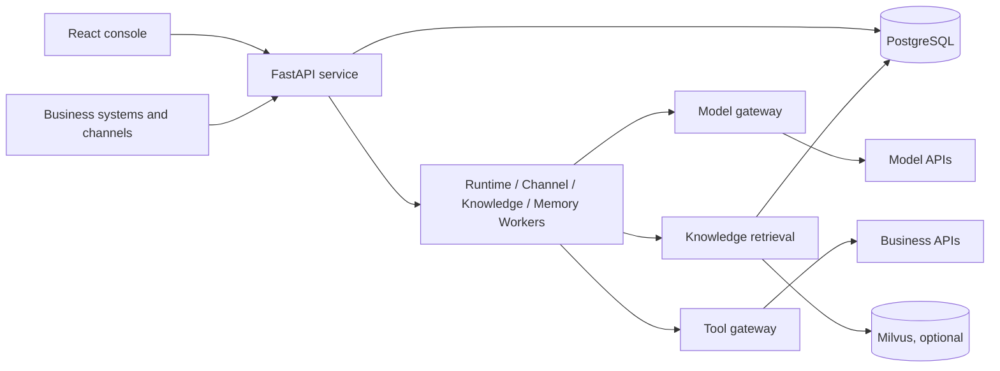

# NexusDesk

**English** · [简体中文](README.zh-CN.md) · [Website](https://www.aidet.top/en/index.html)

> Chinese-speaking users: see the [简体中文 README](README.zh-CN.md).

[](https://github.com/GroundedCoreAI/nexusdesk/actions/workflows/ci.yml) [](LICENSE) [](https://github.com/GroundedCoreAI/nexusdesk/releases) [](https://hub.docker.com/r/groundedcore/nexusdesk-quickstart) [](https://www.aidet.top/en/index.html)

**Self-hosted AI customer service that can retrieve, act, and hand off.**

NexusDesk is built for teams that need to keep customer service data on their own infrastructure. Agents retrieve knowledge, call business tools, and decide what to do next based on execution results. The Harness handles permissions, execution boundaries, memory, human handoff, and audit.

The Harness is not another agent; it is the engineering control layer around the agent execution loop.

**The default deployment requires only PostgreSQL.** PostgreSQL handles data storage, job queues, and cross-process messaging. Redis, dedicated message queues, Kubernetes, and other infrastructure can be added as throughput, latency, isolation, or availability requirements grow. The initial deployment still starts with one Compose file.

[Quickstart](#quickstart) · [Production deployment](#production-deployment) · [Core capabilities](#core-capabilities) · [Architecture](#architecture-overview)


## Quickstart

Requires Docker and Docker Compose v2. On Docker Desktop, use Linux containers.

**Option 1: build locally.** The first run requires network access and compiles the frontend.

```bash
# Linux / macOS
sh nexusdesk quickstart
```

```powershell
# Windows PowerShell
.\nexusdesk.ps1 quickstart
```

**Option 2: use the published image.**

```bash
NEXUSDESK_IMAGE_REGISTRY=docker.io/groundedcore/ NEXUSDESK_VERSION=latest \
  docker compose -f deploy/quickstart/compose.yaml up -d
```

Open **https://localhost:8080** and choose the `sample-support` conversation:

- Enter `发货需要多久？` to try knowledge Q&A.
- Enter `帮我创建工单` to try drafting, human confirmation, and ticket creation.

The quickstart uses a self-signed certificate, so the browser will warn on first access. See the [deployment guide](deploy/README.md#体验模式的-https) for certificate setup and LAN access.

Nine industry case sets are also included: 9 knowledge bases, 18 agent drafts, and 36 documents. Every resource name carries the `[案例]` prefix and can be filtered on the Agent page.

> **Security note:** the quickstart uses a mock model and does not represent real answer quality. The default credentials `admin / nexusdesk` are for local evaluation only and are not an authentication boundary. Keep the default `127.0.0.1` binding; if you expose the service, restrict access with a security group or firewall.

## Production deployment

Copy the configuration template, fill in role tokens and the external PostgreSQL connection, and enable Milvus / S3 as needed:

```bash
# Linux / macOS
cp deploy/production/.env.example deploy/production/.env
# Edit deploy/production/.env
sh nexusdesk deploy
```

```powershell
# Windows PowerShell
Copy-Item deploy/production/.env.example deploy/production/.env
# Edit deploy/production/.env
.\nexusdesk.ps1 deploy
```

Open **http://localhost:8080** and enter the configured role token under Access and Policy. The platform can start without a default model; configure and publish a Chat profile, bind it to an agent, and then start a conversation.

The production topology includes six long-running services — API, Runtime Worker, Channel Worker, Knowledge Worker, Memory Worker, and Web — plus a one-shot migration task. See the [deployment guide](deploy/README.md) for HTTPS, backup, upgrade, and external access configuration.

## Core capabilities

| Capability | What it provides |
| --- | --- |
| Agent configuration and execution | Configure, publish, and roll back agents; run reasoning and tool calls through an asynchronous LangGraph ReAct loop |
| Knowledge and retrieval | Manage documents, chunks, indexes, and published versions, with keyword retrieval and optional Milvus |
| Agent memory | Configure read/write, extraction and review modes, and injection limits, and inspect customer-level memory |
| Model gateway | Manage connections and versioned profiles for Chat, Embedding, Rerank, OCR, and speech models |
| Tools and business integration | Connect business APIs and manage credentials, parameters, permissions, and execution results |
| Human collaboration and tickets | Support conversation takeover, ticket drafting, and human confirmation for follow-up work |
| Channels and open platform | Connect customer service capabilities through channel APIs, application APIs, and SSE |
| Observability and evaluation | Review execution records, model and tool calls, evaluation results, and operation audit |

Typical flow: customer asks a question → the agent retrieves knowledge or calls a tool → the result is returned → a human handoff or confirmed ticket creation follows as needed.

## Why NexusDesk

When an agent can read tool results and adjust its next action, not every business path needs to be fixed as a complete workflow up front. NexusDesk focuses on:

- **Dynamic decisions where they fit:** within configured limits, the agent chooses knowledge retrieval or tool calls, and ReAct feeds execution results into the next decision.
- **Explicit boundaries for high-impact actions:** permissions, parameter validation, execution limits, and human confirmation are not left to the model.
- **Infrastructure that scales on demand:** PostgreSQL is the default requirement; Milvus and S3 are optional, and dedicated middleware or cluster capabilities can be added as scale or availability requirements grow.

This is not about replacing every workflow with an agent. Paths that must remain deterministic should stay under deterministic control.

## Channels and integrations

| Category | Supported |
| --- | --- |
| Messaging platforms | WeCom, WeChat Customer Service, Feishu, DingTalk, Slack, Telegram, Discord |
| Enterprise identity | OIDC, WeCom, DingTalk, Feishu |
| Model access | Any OpenAI-compatible service; Chat / Embedding / Rerank / OCR / speech |
| Knowledge sources | External parser, TXT / Markdown; optional Milvus vector index and MinIO / S3 archive |
| Open access | Embedded chat widget, channel API, signed webhooks, idempotency keys, SSE streaming |
| UI languages | Simplified Chinese, Traditional Chinese, English, Hindi |

## Current status and limits

- **Retrieval:** the runtime defaults to keyword search; Milvus vector retrieval is not yet validated end to end.
- **Tools:** built-in tools and HTTP integrations are available; the MCP adapter is still planned.
- **Quickstart:** uses a mock model, connects to no real business system, and does not represent real model quality.
- **Deployment:** Docker Compose only; no Kubernetes or Helm charts yet.
- **Overall status:** the project is under continuous development and is not production ready out of the box. See the [module delivery notes](docs/modules-delivery.md).

## Architecture overview



NexusDesk is a modular monolith: the API and workers share one backend codebase and are deployed as separate processes. PostgreSQL stores business data and the task queue; Milvus, S3, and an external parsing service are enabled per feature.

| Layer | Technology |
| --- | --- |
| Frontend | TypeScript, React, Ant Design, Vite |
| Backend and execution | Python, FastAPI, LangGraph |
| Data and migrations | PostgreSQL, SQLAlchemy, Alembic |
| Knowledge storage | Milvus, MinIO / S3 (optional) |
| Deployment | Docker Compose, Nginx |

Using external model services requires no GPU on the application server. See the [middleware guide](docs/middleware.md) for details.

## Documentation

The documents listed below are currently written in Simplified Chinese.

| I want to... | Document |
| --- | --- |
| Use the customer service workbench | [Platform guide](docs/platform.md) |
| Deploy, upgrade, or migrate data | [Docker deployment guide](deploy/README.md) |
| Understand middleware and configuration | [Middleware guide](docs/middleware.md) |
| Start a local development environment | [Local development](docs/local-development.md) |
| Understand the architecture and extension modules | [Module architecture](docs/architecture.md) |
| Understand agent execution | [Runtime documentation](docs/runtime.md) |
| Configure the knowledge base | [Knowledge workspace](docs/knowledge-workspace.md) |
| Integrate model services | [Model gateway protocol](backend/src/agent_platform/modules/model_gateway/PROTOCOL.md) |
| Integrate business applications | [API reference](docs/api.md) · [Open platform](docs/open-platform.md) |
| See what changed in a release | [Changelog](CHANGELOG.en.md) |

## Roadmap

- Expand business tool and channel integrations for real customer service scenarios.
- Validate knowledge retrieval quality, large-document handling, and task recovery.
- Improve identity integration, runtime monitoring, backup and recovery, and deployment experience.

See the [module architecture](docs/architecture.md) for module-level plans.

## Contributing

Contributions are welcome through issue reports, documentation improvements, test cases, and code.

- Use the [issue templates](https://github.com/GroundedCoreAI/nexusdesk/issues/new/choose) and include reproduction steps, deployment mode, and sanitized logs.
- Read the [contributing guide](CONTRIBUTING.md) before contributing code.
- Use [Discussions](https://github.com/GroundedCoreAI/nexusdesk/discussions) for design-level topics.

Do not include API keys, access tokens, or customer privacy data in issue reports, screenshots, or code.

For commercial partnerships and private deployment enquiries, visit the [website](https://www.aidet.top/en/contact.html).

## License

This project is licensed under the [Apache License 2.0](LICENSE).
