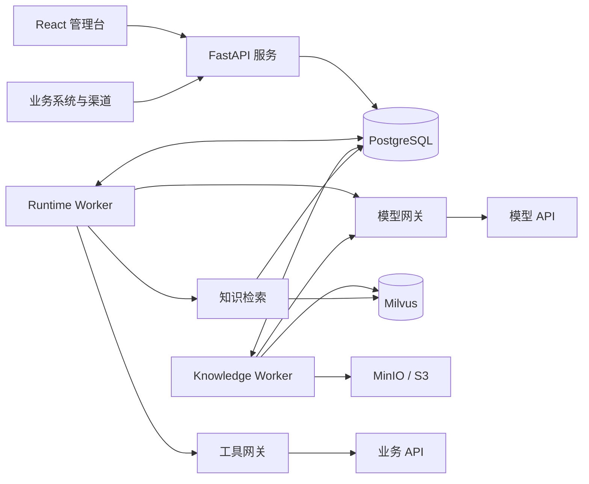

# NexusDesk

简体中文 · [English](README.en.md) · [官网](https://www.aidet.top)

[](https://github.com/GroundedCore/nexusdesk/actions/workflows/ci.yml) [](LICENSE) [](https://github.com/GroundedCore/nexusdesk/releases) [](https://hub.docker.com/r/groundedcore/nexusdesk-quickstart) [](https://www.aidet.top)

**基于 AI Agent 的智能客服与服务协同平台。**

面向需要把客服数据留在自己内网的团队，可视为 **Intercom / Zendesk 的 self-hosted 轻量替代**（Apache-2.0；该赛道多数同类项目为 AGPL-3.0）。

NexusDesk 将知识检索、业务工具调用、人工协同与工单处理连接到统一的客服流程中，帮助团队构建能够回答问题、执行任务并跟进处理结果的智能客服。基于 Python、LangGraph 与 React 构建。

**不需要 Redis，不需要 K8s。** 一个 Postgres 同时承担数据存储与任务队列，一份 Compose 文件即可跑起来。


演示主线：提问 → 命中知识引用 → Agent 拟定工单 → 人工确认 → 创建工单。体验模式使用模拟模型，仅用于演示流程，不代表真实回答质量。

```bash
sh nexusdesk quickstart    # 两个容器，无需模型密钥
```

启动后打开 **https://localhost:8080**，进入 `sample-support` 会话即可试：

- 输入「发货需要多久？」→ 体验知识检索问答
- 输入「帮我创建工单」→ 体验拟定 → 人工确认 → 创建

> 体验模式自带自签证书，首次访问会提示证书不受信任，导入容器内 `/data/tls/ca.crt` 即可消除（详见[快速体验](#快速体验)）。

[快速体验](#快速体验) · [生产部署](#生产部署) · [为什么是 NexusDesk](#为什么是-nexusdesk) · [文档导航](#文档导航) · [参与贡献](#参与贡献)

> 项目处于持续开发阶段，已具备可运行的客服核心流程。功能现状与规划分别说明，部署验证范围见 [验证记录](deploy/validation-20260923.md)。

## 为什么是 NexusDesk

以下三条不是功能列表，是我们在架构上做出的取舍。

| 取舍 | 具体做法 | 对谁有意义 |
| --- | --- | --- |
| **运维面更小** | Postgres 同时承担数据存储、任务队列与跨进程消息通道，不使用 Redis | 需要部署到客户内网、走安全评审、运维人力有限的场景。每少一个中间件，就少一轮评审、少一份运维手册、少一个故障点 |
| **写操作由人工把关** | Agent 不能直接执行不可逆的业务动作。以创建工单为例，Agent 只能**拟定**，人工确认后才真正创建；会话中也可随时转人工接管 | 不允许 AI 自动改动业务系统的团队 |
| **每次变更都可追溯** | Agent 配置采用草稿／发布／回滚三态，可对比版本差异；模型调用有配额与计量；运行有完整事件日志，操作有审计记录 | 需要过合规与安全评审、要求变更可回退的场景 |

## 渠道与集成

| 类别 | 已支持 |
| --- | --- |
| 渠道接入 | 嵌入聊天组件、渠道接口（HMAC 签名 + 消息 ID 去重）、开放平台 API（签名 Webhook 与重试、幂等键、SSE 流式输出） |
| 消息平台 | 企业微信、微信客服、飞书、钉钉、Slack、Telegram、Discord（原生适配） |
| 企业身份 | OIDC、企业微信、钉钉、飞书 |
| 模型接入 | 任意 OpenAI 兼容服务；Chat / Embedding / Rerank / OCR / 语音，连接与版本方案统一管理 |
| 知识来源 | 外部 Parser（PDF、Office、图片等，取决于 Parser 实现）、TXT / Markdown 直读；Milvus 向量索引、MinIO / S3 归档（按需启用） |
| 中间件 | **仅需 PostgreSQL**；Milvus、S3 按需启用，**不使用 Redis** |
| 部署形态 | Docker Compose：体验 2 容器 / 生产 6 个常驻服务 + 一次性迁移任务；暂无 K8s、Helm |
| 界面语言 | 简体中文、繁体中文、英文、印地语 |

## 与同类项目的差异

| 维度 | NexusDesk | 通用 LLM 应用平台 | 知识库问答平台 | 开源客服工单系统 |
| --- | --- | --- | --- | --- |
| 定位 | 客服与服务协同 | 通用应用编排 | 知识库问答 | 人工客服工单 |
| 工单与人工接管闭环 | 内置 | 需自行搭建 | 需自行搭建 | 内置 |
| 写操作需人工确认 | 内置 | 需自行实现 | 需自行实现 | 不适用 |
| Redis 是否必需 | 不需要 | 需要 | 需要 | 需要 |
| Agent 版本化与回滚 | 内置 | 部分支持 | 部分支持 | 不适用 |
| 模型调用配额与计量 | 内置 | 部分支持 | 部分支持 | 不适用 |
| 许可证 | Apache-2.0 | 见各自仓库 | 见各自仓库 | 见各自仓库 |

同类项目的信息以其官方文档为准，建议自行核对；本表仅用于说明设计取向的差异，不构成对任何产品的评价。

### 当前实现状态（如实说明）

- 检索：Runtime 默认使用**关键词检索**；向量检索需要自行配置 Milvus，端到端联调尚未完成。
- 体验模式使用**模拟模型**，不代表真实回答质量；不连接真实业务系统。
- 部署：只提供 **Docker Compose**，暂无 K8s / Helm 清单。
- 项目处于持续开发阶段，**尚未达到开箱即用的生产可用程度**。详见 [模块交付说明](docs/modules-delivery.md)。

## 产品预览


知识库工作台：管理文档、分片、索引和发布版本。截图使用测试数据。

## 核心能力

| 能力 | 可以做什么 |
| --- | --- |
| Agent 配置与执行 | 配置并发布 Agent，通过异步 LangGraph ReAct 循环执行推理与工具调用 |
| 知识库与检索 | 接入文档、配置分片、预览内容、构建向量索引并测试检索效果 |
| 统一模型接入 | 管理 Chat、Embedding、Rerank、OCR 和语音模型的连接、目录及版本方案 |
| 业务工具集成 | 接入业务 API，管理调用凭据、参数与执行权限 |
| 人工协同与工单 | 支持会话接管、工单拟定及确认，让需要后续处理的问题进入服务流程 |
| 渠道与应用接入 | 通过渠道接口和应用 API 将客服能力接入业务系统 |
| 运行观测与评估 | 查看执行记录、工具调用和评估结果，辅助排查问题与持续改进 |

典型流程：用户发起咨询 → Agent 检索知识或调用业务工具 → 返回结果 → 按需转人工或确认创建工单。

## 快速体验

需要 Docker 与 Docker Compose v2（Docker Desktop 请选择 Linux 容器模式），两种启动方式任选其一。

**方式一：本地构建。** 在项目根目录执行，首次需要联网并编译前端，耗时几分钟。

```bash
# Linux / macOS
sh nexusdesk quickstart
```

```powershell
# Windows PowerShell
.\nexusdesk.ps1 quickstart
```

**方式二：用已发布的镜像。** 跳过前端编译，直接用预构建镜像启动，在项目根目录执行。

```bash
NEXUSDESK_IMAGE_REGISTRY=docker.io/groundedcore/ NEXUSDESK_VERSION=latest \
  docker compose -f deploy/quickstart/compose.yaml up -d
```

镜像同时发布在 [GHCR](https://github.com/GroundedCore/nexusdesk/pkgs/container/nexusdesk-quickstart) 和 [Docker Hub](https://hub.docker.com/r/groundedcore/nexusdesk-quickstart)，内容一致，按网络任选：Docker Hub 对匿名拉取有速率限制，GHCR 没有。`NEXUSDESK_VERSION` 需要显式指定，默认值 `local` 只存在于本地构建。

不想克隆仓库时，取这一个 compose 文件就够，在任意目录执行：

```bash
curl -fsSLo compose.yaml \
  https://raw.githubusercontent.com/GroundedCore/nexusdesk/main/deploy/quickstart/compose.yaml

NEXUSDESK_IMAGE_REGISTRY=docker.io/groundedcore/ NEXUSDESK_VERSION=latest \
  docker compose -f compose.yaml up -d
```

打开 **https://localhost:8080**，进入会话工作台的 `sample-support`：

- 输入“发货需要多久？”体验知识问答。
- 输入“帮我创建工单”体验拟定、确认与创建流程。

体验模式自带一套自签证书，因此通过局域网 IP 或内网域名访问时同样是安全上下文，浏览器的安全上下文限制（如 `crypto.randomUUID`、剪贴板）不会成为障碍。首次访问会提示证书不受信任，导入容器内 `/data/tls/ca.crt` 后即可消除；用局域网地址访问时通过 `NEXUSDESK_TLS_HOSTS` 让证书覆盖该地址，详见 [部署手册](deploy/README.md#体验模式的-https)。

同时预置 9 个行业案例：9 个知识库、18 个 Agent 草稿和 36 篇文档，资源名均带 `[案例]` 前缀，可在 Agent 管理页用“仅看案例”筛选；案例 Agent 已自动绑定演示 Chat 方案，可直接试聊。

仅启动 App + PostgreSQL 两个容器，无需模型密钥。预置场景使用模拟模型，页面显示演示标识，仅供本机体验，不代表真实模型回答质量。

> **安全提醒**：体验入口不注入任何身份，未携带凭据的请求会被 API 直接拒绝；但登录口令 `admin / nexusdesk` 是公开写在仓库里的，因此这道防线只挡扫描器和误入者，不构成认证边界。请保持默认的 `127.0.0.1` 绑定，确需对公网开放时用安全组或防火墙把端口限制为可信 IP。

## 生产部署

复制配置模板，填写角色 Token 和外部 PostgreSQL，按需配置 Milvus / S3，然后启动：

```bash
# Linux / macOS（仅首次部署复制模板）
cp deploy/production/.env.example deploy/production/.env
# 编辑 deploy/production/.env，替换占位符
sh nexusdesk deploy
```

```powershell
# Windows PowerShell（仅首次部署复制模板）
Copy-Item deploy/production/.env.example deploy/production/.env
# 编辑 deploy/production/.env，替换占位符
.\nexusdesk.ps1 deploy
```

默认访问 **http://localhost:8080**，在“访问与策略”填写配置的角色 Token。平台无需默认模型即可启动；在模型网关配置并发布 Chat 方案，绑定到 Agent 后开始对话。

生产拓扑拆分为 API、Runtime Worker、Channel Worker、Knowledge Worker、Memory Worker 与 Web 六个常驻服务，并执行独立的一次性迁移任务。复用已有数据库前需恢复原始凭据主密钥；HTTPS、备份、升级与外部访问配置见 [部署手册](deploy/README.md)。

## 架构概览



采用模块化单体架构，API 与 Worker 共用后端代码，按进程独立部署。PostgreSQL 保存业务数据和任务队列；Milvus、S3 与外部解析服务按功能启用。

| 层次 | 技术 |
| --- | --- |
| 前端 | TypeScript、React、Ant Design、Vite |
| 后端与执行 | Python、FastAPI、LangGraph |
| 数据与迁移 | PostgreSQL、SQLAlchemy、Alembic |
| 知识存储 | Milvus、MinIO / S3（按需配置） |
| 部署 | Docker Compose、Nginx |

详细依赖见 [中间件说明](docs/middleware.md)。普通客服业务通过 API 工具调用；使用外部模型服务时，应用服务器无需 GPU。

## 文档导航

| 我想要…… | 文档 |
| --- | --- |
| 使用客服工作台 | [平台使用说明](docs/platform.md) |
| 部署、升级或迁移数据 | [Docker 部署手册](deploy/README.md) |
| 了解中间件与配置 | [中间件说明](docs/middleware.md) |
| 启动本地开发环境 | [本地开发](docs/local-development.md) |
| 了解架构和扩展模块 | [模块架构](docs/architecture.md) · [模块开发规范](docs/module-development.md) |
| 理解 Agent 执行机制 | [Runtime 文档](docs/runtime.md) |
| 配置知识库 | [知识库工作台](docs/knowledge-workspace.md) |
| 接入模型服务 | [模型网关协议](backend/src/agent_platform/modules/model_gateway/PROTOCOL.md) |
| 接入业务应用 | [API 说明](docs/api.md) · [开放平台](docs/open-platform.md) |
| 管理数据库变更 | [迁移指南](docs/database-migrations.md) |
| 查看版本更新 | [更新日志](CHANGELOG.md) |

## 后续方向

以下为持续完善方向，不代表已交付能力或发布承诺：

- 扩展业务工具与渠道适配，完善实际客服场景。
- 持续验证知识检索质量、大文档处理与任务恢复能力。
- 完善身份接入、运行监控、备份恢复与容量验证。
- 改进开发文档、自动化验证及部署体验。

各模块的设计与实施范围见 [模块规划索引](docs/architecture.md)。

## 商务合作

社区版采用 Apache-2.0，可免费自托管。以下场景欢迎与我们联系：

- **私有化部署与实施** —— 内网与信创环境，以及与既有业务系统的对接
- **企业版授权** —— 合规治理、多租户运营、高可用部署
- **行业加速包** —— 开箱即用的行业客服 Agent 配置与评测集

联系方式与报价见 [官网咨询](https://www.aidet.top/contact.html)。不确定是否适合，也欢迎先聊一次。

## 参与贡献

欢迎通过问题反馈、文档改进、测试用例与代码贡献参与建设。

- 提交问题请使用 [issue 模板](https://github.com/GroundedCore/nexusdesk/issues/new/choose)，并说明使用场景、复现步骤、部署方式与脱敏日志。
- 贡献代码前请阅读 [贡献指南](CONTRIBUTING.md)，其中包含开发环境、提交前自检与若干项目约定。
- 方案层面的讨论欢迎到 [Discussions](https://github.com/GroundedCore/nexusdesk/discussions)。

请勿在问题报告、截图或代码中包含 API Key、访问令牌及客户隐私数据。

## 许可证

本项目采用 [Apache License 2.0](LICENSE) 许可。
