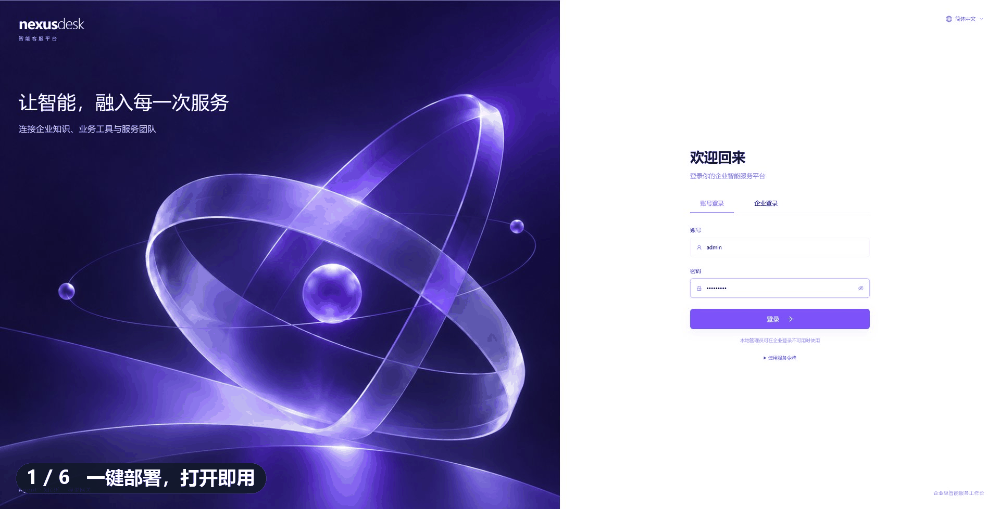
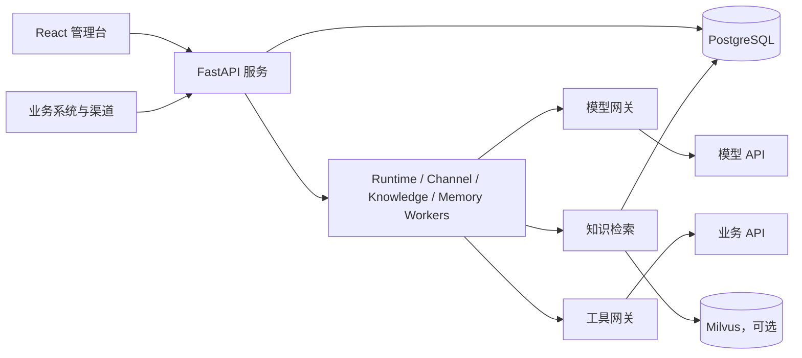

# NexusDesk

**简体中文** · [English](README.md) · [官网](https://www.aidet.top)

> This is the Simplified Chinese README. The repository home page shows the default [English README](README.md).

[](https://github.com/GroundedCore/nexusdesk/actions/workflows/ci.yml) [](LICENSE) [](https://github.com/GroundedCore/nexusdesk/releases) [](https://hub.docker.com/r/groundedcore/nexusdesk-quickstart) [](https://www.aidet.top)

**能检索、能行动、能交接的自托管 AI 客服平台。**

NexusDesk 面向需要将客服数据保留在自有基础设施中的团队。Agent 可以检索知识、调用业务工具，并根据执行结果决定下一步行动；Harness 负责权限、执行边界、记忆、人工协同与审计。

这里的 Harness 不是另一个 Agent，而是围绕 Agent 执行过程的工程控制层。

**默认部署只需要 PostgreSQL。** PostgreSQL 同时承担数据存储、任务队列与跨进程消息通道；当吞吐、延迟、隔离或可用性要求提升时，可以按需扩展 Redis、专用消息队列或 Kubernetes 等基础设施。初始部署只需一份 Compose 文件。

[快速体验](#快速体验) · [生产部署](#生产部署) · [核心能力](#核心能力) · [架构概览](#架构概览)



## 快速体验

需要 Docker 与 Docker Compose v2。Docker Desktop 请选择 Linux 容器模式。

**方式一：本地构建。** 首次运行需要联网并编译前端。

```bash
# Linux / macOS
sh nexusdesk quickstart
```

```powershell
# Windows PowerShell
.\nexusdesk.ps1 quickstart
```

**方式二：使用已发布镜像。**

```bash
NEXUSDESK_IMAGE_REGISTRY=docker.io/groundedcore/ NEXUSDESK_VERSION=latest \
  docker compose -f deploy/quickstart/compose.yaml up -d
```

启动后打开 **https://localhost:8080**，进入 `sample-support` 会话：

- 输入「发货需要多久？」体验知识问答。
- 输入「帮我创建工单」体验拟定、人工确认和创建流程。

体验模式自带自签证书，首次访问会提示证书不受信任。证书配置和局域网访问说明见[部署手册](deploy/README.md#体验模式的-https)。

同时预置 9 个行业案例：9 个知识库、18 个 Agent 草稿和 36 篇文档，资源名均带 `[案例]` 前缀，可在 Agent 管理页筛选。

> **安全提醒**：体验模式使用模拟模型，不代表真实回答质量。默认账号 `admin / nexusdesk` 仅用于本地体验，不构成生产认证边界。请保持默认 `127.0.0.1` 绑定；如需开放访问，请使用安全组或防火墙限制可信 IP。

## 生产部署

复制配置模板，填写角色 Token 和外部 PostgreSQL，按需配置 Milvus / S3：

```bash
# Linux / macOS
cp deploy/production/.env.example deploy/production/.env
# 编辑 deploy/production/.env
sh nexusdesk deploy
```

```powershell
# Windows PowerShell
Copy-Item deploy/production/.env.example deploy/production/.env
# 编辑 deploy/production/.env
.\nexusdesk.ps1 deploy
```

默认访问 **http://localhost:8080**。平台无需默认模型即可启动；在模型网关配置并发布 Chat 方案、绑定 Agent 后即可对话。

生产拓扑包含 API、Runtime Worker、Channel Worker、Knowledge Worker、Memory Worker、Web 六个常驻服务和一次性的迁移任务。HTTPS、备份、升级与外部访问配置见[部署手册](deploy/README.md)。

## 核心能力

| 能力 | 说明 |
| --- | --- |
| Agent 配置与执行 | 配置、发布和回滚 Agent，通过异步 LangGraph ReAct 循环执行推理与工具调用 |
| 知识库与检索 | 管理文档、分片、索引和发布版本，支持关键词检索与按需启用 Milvus |
| Agent 记忆 | 配置记忆读写、抽取与确认模式、注入限制，并查看客户维度的记忆内容 |
| 模型网关 | 统一管理 Chat、Embedding、Rerank、OCR 和语音模型的连接与版本方案 |
| 工具与业务接入 | 接入业务 API，管理调用凭据、参数、权限和执行结果 |
| 人工协同与工单 | 支持会话接管、工单拟定和人工确认，让需要跟进的问题进入服务流程 |
| 渠道与开放平台 | 通过渠道接口、应用 API 和 SSE 将客服能力接入业务系统 |
| 运行观测与评估 | 查看执行记录、模型与工具调用、评估结果和操作审计 |

典型流程：用户咨询 → Agent 检索知识或调用工具 → 返回结果 → 按需转人工或确认创建工单。

## 为什么是 NexusDesk

当 Agent 能够读取工具结果并调整下一步行动时，不必把所有业务路径都提前固化为完整流程。NexusDesk 的设计重点是：

- **适合动态判断的问题交给 Agent**：Agent 在配置范围内选择知识检索或工具调用，ReAct 让执行结果参与下一步决策。
- **高风险动作保留明确边界**：权限、参数校验、执行限制和人工确认不由模型自行决定。
- **基础设施按需扩展**：默认只需要 PostgreSQL，Milvus、S3 等能力按需启用；更高规模或更高可用性要求出现后，再引入专用中间件和集群能力。

这不是用 Agent 替代所有工作流。路径必须确定的地方仍应保持确定性控制。

## 渠道与集成

| 类别 | 已支持 |
| --- | --- |
| 消息平台 | 企业微信、微信客服、飞书、钉钉、Slack、Telegram、Discord |
| 企业身份 | OIDC、企业微信、钉钉、飞书 |
| 模型接入 | 任意 OpenAI 兼容服务；Chat / Embedding / Rerank / OCR / 语音 |
| 知识来源 | 外部 Parser、TXT / Markdown；Milvus 向量索引、MinIO / S3 归档按需启用 |
| 开放接入 | 嵌入聊天组件、渠道 API、签名 Webhook、幂等键、SSE 流式输出 |
| 界面语言 | 简体中文、繁体中文、英文、印地语 |

## 当前状态与边界

- **知识检索**：Runtime 默认使用关键词检索；Milvus 向量检索尚未完成端到端验证。
- **工具接入**：内置工具与 HTTP 接入可用；MCP 适配仍在规划中。
- **快速体验**：使用模拟模型，不连接真实业务系统，不代表真实模型回答质量。
- **部署形态**：目前仅提供 Docker Compose，暂无 Kubernetes / Helm。
- **整体状态**：项目仍在持续开发，尚未达到开箱即用的生产可用程度。详见[模块交付说明](docs/modules-delivery.md)。

## 架构概览



采用模块化单体架构，API 与 Worker 共用后端代码，按进程独立部署。PostgreSQL 保存业务数据和任务队列；Milvus、S3 与外部解析服务按功能启用。

| 层次 | 技术 |
| --- | --- |
| 前端 | TypeScript、React、Ant Design、Vite |
| 后端与执行 | Python、FastAPI、LangGraph |
| 数据与迁移 | PostgreSQL、SQLAlchemy、Alembic |
| 知识存储 | Milvus、MinIO / S3（按需配置） |
| 部署 | Docker Compose、Nginx |

使用外部模型服务时，应用服务器无需 GPU。详细依赖见[中间件说明](docs/middleware.md)。

## 文档导航

| 我想要…… | 文档 |
| --- | --- |
| 使用客服工作台 | [平台使用说明](docs/platform.md) |
| 部署、升级或迁移数据 | [Docker 部署手册](deploy/README.md) |
| 了解中间件与配置 | [中间件说明](docs/middleware.md) |
| 启动本地开发环境 | [本地开发](docs/local-development.md) |
| 了解架构和扩展模块 | [模块架构](docs/architecture.md) |
| 理解 Agent 执行机制 | [Runtime 文档](docs/runtime.md) |
| 配置知识库 | [知识库工作台](docs/knowledge-workspace.md) |
| 接入模型服务 | [模型网关协议](backend/src/agent_platform/modules/model_gateway/PROTOCOL.md) |
| 接入业务应用 | [API 说明](docs/api.md) · [开放平台](docs/open-platform.md) |
| 查看版本更新 | [更新日志](CHANGELOG.md) |

## 后续方向

- 扩展业务工具和渠道适配，完善真实客服场景。
- 验证知识检索质量、大文档处理和任务恢复能力。
- 改进身份接入、运行监控、备份恢复和部署体验。

各模块规划见[模块架构](docs/architecture.md)。

## 参与贡献

欢迎通过问题反馈、文档改进、测试用例和代码贡献参与建设。

- 提交问题请使用 [issue 模板](https://github.com/GroundedCore/nexusdesk/issues/new/choose)，并提供复现步骤、部署方式和脱敏日志。
- 贡献代码前请阅读[贡献指南](CONTRIBUTING.md)。
- 方案讨论欢迎前往 [Discussions](https://github.com/GroundedCore/nexusdesk/discussions)。

请勿在问题报告、截图或代码中包含 API Key、访问令牌及客户隐私数据。

商业合作与私有化部署咨询见[官网](https://www.aidet.top/contact.html)。

## 许可证

本项目采用 [Apache License 2.0](LICENSE) 许可。
